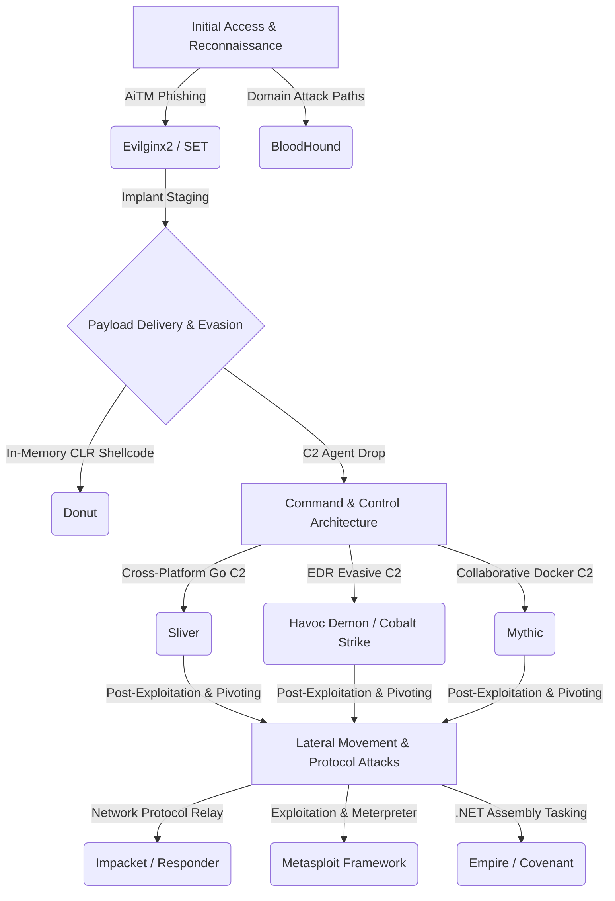

  

  
  
  
  
  

---

# 🛡️ Awesome Penetration Testing Frameworks

> A curated directory of battle-tested **Penetration Testing Frameworks**, **Command-and-Control (C2) Platforms**, **Adversary Simulation Suites**, and **Post-Exploitation Toolkits** for authorized red teams, penetration testers, and offensive security researchers.

Penetration testing frameworks provide the mission-critical offensive security infrastructure required for authorized adversary simulation — including exploit weaponization, payload delivery, staged implant generation, multi-protocol session management, and robust command-and-control (C2). These platforms empower red teams and enterprise defenders to rigorously test detection pipelines, validate blue team response playbooks, and fortify enterprise resilience against advanced persistent threats (APTs).

---

## 📑 Table of Contents

- [📊 Sector Overview & Market Dynamics](#-sector-overview--market-dynamics)
- [🏢 Enterprise & SaaS Penetration Testing Platforms](#-enterprise--saas-penetration-testing-platforms)
- [🔓 Open-Source Penetration Testing & C2 Frameworks](#-open-source-penetration-testing--c2-frameworks)
- [🏗️ Framework Selection & Tradecraft Guide](#️-framework-selection--tradecraft-guide)
- [🤝 How to Contribute](#-how-to-contribute)
- [⚠️ Disclaimer & Ethical Use Policy](#️-disclaimer--ethical-use-policy)
- [⭐ Star History](#-star-history)
- [💖 Support & Community](#-support--community)

---

## 📊 Sector Overview & Market Dynamics

The global **Penetration Testing and Adversary Simulation** sector is valued between **$2.72 Billion and $3.09 Billion in 2026** and is projected to expand at a compound annual growth rate (**CAGR of 15.2%**) to exceed **$5.5 Billion by 2030**. This growth is heavily accelerated by mandatory regulatory compliance standards (such as **EU DORA**, **NIS2**, and **PCI DSS v4.0** requirements for threat-led penetration testing) and the enterprise shift toward Continuous Automated Red Teaming (CART) and Penetration Testing as a Service (PTaaS).

The market is **moderately fragmented** rather than a winner-take-all monopoly: while established defense conglomerates and private equity cybersecurity platforms (such as Fortra's Cobalt Strike and Core Impact, or Rapid7's Metasploit Pro) command large enterprise market share, persistent demand for evasive tradecraft has fueled rapid adoption of modern AI-driven autonomous pentesting platforms (such as Horizon3.ai and Cymulate) and a thriving, highly extensible open-source C2 ecosystem.

---

## 🏢 Enterprise & SaaS Penetration Testing Platforms

The following table indexes leading enterprise-grade commercial penetration testing, adversary simulation, and C2 platforms. The table is ordered in descending order by parent company scale (valuation or annual revenue).

| 🏢 Platform / SaaS | 📈 Company Scale (Valuation / Revenue) | 💳 Starting Tier Pricing | ⏳ Free Tier & Trial Limits | 🎯 Primary Capabilities & Red Team Focus |
| :--- | :--- | :--- | :--- | :--- |
| **[Immunity CANVAS](https://www.immunityinc.com/)** | **~$165B Valuation** *(RTX Corp / Raytheon; ~$74B Annual Rev)* | **$3,200 / user / year** *(Standard 1-user license; 30 targets/test)* | **14-day vetted evaluation** *(Restricted non-production targets; requires corporate domain verification)* | Commercial exploitation framework with 800+ zero/n-day automated exploits, remote unauthenticated flaw targeting, and specialized SCADA/ICS exploit packs. |
| **[Core Impact](https://www.coresecurity.com/)** | **~$3.5B - $4.0B Valuation** *(Fortra; ~$800M+ Annual Rev)* | **$9,450 / user / year** *(Core Impact Basic tier; Pro tier at $12,600/yr)* | **7-day cloud sandbox trial** *(Hosted interactive environment with guided attack paths; vetted business emails)* | Multi-vector adversary simulation spanning network, client-side phishing, web apps, and wireless; native Impacket protocol integration and automated pivoting wizards. |
| **[Cobalt Strike](https://www.cobaltstrike.com/)** | **~$3.5B - $4.0B Valuation** *(Fortra; ~$800M+ Annual Rev)* | **$3,540 / user / year** *(Standard per-seat annual license; initial packages ~$5,900/yr)* | **21-day trial** *(Strictly vetted corporate red teams; watermarked Beacon payloads with identifiable egress indicators)* | The industry-standard adversary emulation framework; features Malleable C2 network traffic profile shaping, Beacon in-memory agents, browser pivoting, and Active Directory integration. |
| **[Metasploit Pro](https://www.rapid7.com/products/metasploit/)** | **~$2.3B Market Cap** *(Rapid7 NASDAQ: RPD; ~$820M Annual Rev)* | **$15,000 / user / year** *(Commercial subscription; public sector schedule ~$12,600/yr)* | **14-day free trial** *(Full commercial capabilities capped at scanning and exploiting a maximum of 32 target IP addresses)* | Commercial enterprise automation for Metasploit, adding multi-host automated exploitation wizards, credential harvesting/reuse tests, phishing campaigns, and audit-ready compliance reporting. |
| **[Horizon3.ai NodeZero](https://www.horizon3.ai/)** | **~$500M Valuation** *(Horizon3.ai Series C; $100M+ raised)* | **$15,000 / year** *(Autonomous Pentest tier; up to 250 internal/external IP assets)* | **14-day free trial** *(Includes 1 full production autonomous penetration test run scoped up to 25 IP assets)* | Autonomous penetration testing as a service (PTaaS); continuously maps exploitable attack paths, verifies active exploitability, and chains credentials without human operator overhead. |
| **[Cymulate BAS](https://cymulate.com/)** | **~$500M Valuation** *(Cymulate Series D; $140M+ raised)* | **$20,000 / year** *(Core attack vector baseline simulation tier)* | **14-day free trial** *(Includes simulation across 5 attack vectors: Email Gateway, Web Gateway, Phishing, Endpoint, and Lateral Movement)* | Extended Security Posture Management (XSPM) and Continuous Automated Red Teaming (CART); continuously validates enterprise detection controls against MITRE ATT&CK matrices. |
| **[Brute Ratel C4](https://bruteratel.com/)** | **~$2.5M Annual Revenue** *(DarkVortex boutique security vendor)* | **$2,500 / user / year** *(Standard Badger operator license; renewal at $2,250/yr)* | **7-day supervised POC demo** *(Strictly vetted defense contractors and Fortune 500 red teams; manual identity background check)* | Adversary simulation and evasion suite engineered specifically to circumvent next-gen EDR/XDR; features indirect system calls, sleep obfuscation, stack spoofing, and Badger payloads. |

---

## 🔓 Open-Source Penetration Testing & C2 Frameworks

A ranked index of leading open-source penetration testing frameworks, adversary emulation platforms, and C2 servers. Sorted in descending order by GitHub community Stars_Count.

### 1. 🎯 [Metasploit Framework](https://github.com/rapid7/metasploit-framework) 
- **Primary Domain**: Universal Exploitation & Post-Exploitation Framework
- **Implementation**: Ruby / C / Python / Go
- **Core Tradecraft**: The world's most widely adopted open-source exploitation framework. Contains over 2,400 exploits, 1,200 auxiliary modules, and 400 post-exploitation scripts. Provides the iconic **Meterpreter** in-memory post-exploitation agent with TLS encryption, token manipulation, system privileges elevation, keystroke logging, and deep network pivoting.
- **Workflow**: `msfconsole` ➔ `search [vulnerability]` ➔ `use [exploit_module]` ➔ `set RHOSTS [target]` ➔ `set PAYLOAD [payload]` ➔ `exploit`
- **Best For**: Baseline penetration tests, vulnerability verification, education, and security control validation.

---

### 2. 🎯 [Impacket](https://github.com/fortra/impacket) 
- **Primary Domain**: Low-Level Network Protocol Exploitation & Active Directory Lateral Movement
- **Implementation**: Python
- **Core Tradecraft**: Essential collection of Python classes for constructing, crafting, and manipulating raw network protocols (SMB1-3, MSRPC, NTLM, Kerberos, TDS, LDAP). Powers foundational red team tools including `psexec.py`, `wmiexec.py`, `secretsdump.py`, `smbexec.py`, `GetUserSPNs.py` (Kerberoasting), and `ntlmrelayx.py`.
- **Workflow**: `impacket-secretsdump -hashes :<ntds_hash> Administrator@<dc_ip>` ➔ `impacket-wmiexec -hashes :<ntlm_hash> Administrator@<target_ip>`
- **Best For**: Windows domain penetration testing, pass-the-hash attacks, Active Directory credential dumping, and network protocol exploitation.

---

### 3. 🎯 [Evilginx2](https://github.com/kgretzky/evilginx2) 
- **Primary Domain**: Adversary-in-the-Middle (AiTM) Phishing & 2FA/MFA Bypass
- **Implementation**: Go
- **Core Tradecraft**: Standalone man-in-the-middle attack framework used for intercepting authentication credentials alongside session tokens/cookies. By proxying live login pages via dynamic phishlets, it allows operators to bypass modern multi-factor authentication (MFA/2FA) including SMS, TOTP, and push authenticators.
- **Workflow**: `evilginx2` ➔ `phishlets config [service]` ➔ `lures create [service]` ➔ capture session authentication tokens in real time.
- **Best For**: Authorized red team initial access campaigns and assessing enterprise resistance to modern phishing techniques.

---

### 4. 🎯 [Social-Engineer Toolkit (SET)](https://github.com/trustedsec/social-engineer-toolkit) 
- **Primary Domain**: Social Engineering & Targeted Initial Access Attacks
- **Implementation**: Python
- **Core Tradecraft**: Maintained by TrustedSec, SET specializes in targeted adversary social engineering vectors: credential harvesting clones, spear-phishing email payload generation, malicious USB mass storage HID emulation, and QR code attacks. Integrates directly with Metasploit for payload delivery.
- **Workflow**: Interactive menu driven: `setoolkit` ➔ Social-Engineering Attacks ➔ Website Attack Vectors ➔ Credential Harvester Method.
- **Best For**: Human-factor security assessments and initial access attack simulations.

---

### 5. 🎯 [Sliver](https://github.com/BishopFox/sliver) 
- **Primary Domain**: Cross-Platform Modern Red Team Command & Control
- **Implementation**: Go (Client, Server, Implants)
- **Core Tradecraft**: Modern, general-purpose multi-user C2 developed by Bishop Fox. Compiles fully self-contained Go binaries (Windows, macOS, Linux) with no external dynamic runtime dependencies. Features multi-protocol egress support (HTTP/S, mTLS, DNS, WireGuard, raw TCP), dynamic process injection, in-memory execution of unmanaged PE/COFF files, and native WireGuard pivot networks.
- **Workflow**: `sliver > generate --http https://c2.domain.com --os windows --arch amd64 --save ./implant.exe` ➔ `sessions -i [id]` ➔ `armory install [package]`
- **Best For**: Modern cross-platform red team engagements requiring resilient, encrypted C2 transport and zero licensing fees.

---

### 6. 🎯 [Pupy](https://github.com/n1nj4sec/pupy) 
- **Primary Domain**: Cross-Platform Remote Administration & In-Memory Post-Exploitation
- **Implementation**: Python / C
- **Core Tradecraft**: Full-featured, multi-platform post-exploitation framework written primarily in Python. Embeds a CPython runtime directly in memory, loading Python packages dynamically without touching disk. Features reflective DLL injection, transparent socks5 proxying, and multiple encrypted transport protocols (SSL, Obfs3, KCP, Scramblesuit).
- **Workflow**: `pupygen.py -O windows -A x64 connect --host c2.server:443` ➔ manage sessions through interactive terminal client.
- **Best For**: In-memory stealth post-exploitation on diverse targets across Windows, Linux, Android, and macOS.

---

### 7. 🎯 [Havoc](https://github.com/HavocFramework/Havoc) 
- **Primary Domain**: Malleable Post-Exploitation & EDR Evasion C2
- **Implementation**: C++ / Qt (Client GUI), Go (Teamserver), C / ASM (Demon Agent)
- **Core Tradecraft**: Contemporary post-exploitation framework built by C5pider. Features a high-performance teamserver and the **Demon** implant written in pure C and Assembly. Integrates cutting-edge evasion mechanisms: sleep obfuscation via Ekko, Foliage, and Ziliean; indirect system call dispatching for `Nt*` APIs; x64 return address stack spoofing; and hardware breakpoint AMSI/ETW patching.
- **Workflow**: Launch teamserver ➔ connect via Qt dark-mode client ➔ generate Demon payload with custom evasion profile ➔ interact with compromise sessions.
- **Best For**: Advanced red team operators conducting adversary emulation against modern endpoint detection and response (EDR) agents.

---

### 8. 🎯 [CALDERA](https://github.com/mitre/caldera) 
- **Primary Domain**: Automated Adversary Emulation & MITRE ATT&CK Mapping
- **Implementation**: Python
- **Core Tradecraft**: Developed by MITRE, CALDERA automates adversary behavioral emulation directly mapped to the **MITRE ATT&CK** framework. Enables security teams to execute coordinated attack chains using pluggable adversary profiles (e.g., APT29, FIN6), automatically testing and scoring detection sensors, SIEM correlation rules, and incident response speed.
- **Workflow**: Web GUI console ➔ Select Adversary Profile ➔ Deploy Sandcat agent ➔ Run automated operations ➔ Review ATT&CK matrix coverage heatmap.
- **Best For**: Blue and purple teams verifying defensive security telemetry and running automated adversary simulations.

---

### 9. 🎯 [Responder](https://github.com/lgandx/Responder) 
- **Primary Domain**: Local Network Credential Poisoning & NTLM Relay
- **Implementation**: Python
- **Core Tradecraft**: LLMNR, NBT-NS, and MDNS poisoner with built-in rogue authentication daemons (HTTP, SMB, MSSQL, FTP, LDAP). Silently listens on internal subnets to answer broadcast name resolution requests, capturing NetNTLMv1/v2 challenge-response hashes or relaying authentications across the enterprise network.
- **Workflow**: `sudo responder -I eth0 -dwv` ➔ listen for multicast requests ➔ extract intercepted NTLM hashes for offline hash cracking with Hashcat.
- **Best For**: Internal network penetration tests and rapid credential gathering during initial subnet discovery.

---

### 10. 🎯 [Merlin](https://github.com/Ne0nd0g/merlin) 
- **Primary Domain**: Cross-Platform Post-Exploitation C2 with Modern Web Protocols
- **Implementation**: Go
- **Core Tradecraft**: Post-exploitation C2 server utilizing modern HTTP/2 and HTTP/3 (QUIC) protocols for encrypted egress. By leveraging multiplexed HTTP/2 frames and UDP-based QUIC, Merlin communications blend seamlessly with legitimate content delivery network (CDN) traffic, evading traditional deep packet inspection (DPI) appliances.
- **Workflow**: Start Merlin teamserver ➔ configure HTTP/2 listener ➔ generate Go agent with domain fronting ➔ execute remote tasks via CLI interface.
- **Best For**: Evading network-layer inspection devices through advanced HTTP/2 and HTTP/3 egress channels.

---

### 11. 🎯 [Empire](https://github.com/BC-SECURITY/Empire) 
- **Primary Domain**: Post-Exploitation & Adversary Emulation Framework
- **Implementation**: Python 3 / C# / PowerShell
- **Core Tradecraft**: Maintained by BC-Security, Empire delivers a modular post-exploitation framework with native support for PowerShell, C#, and Python 3 agents. Includes over 400 offensive modules (e.g., Mimikatz, Seatbelt, Rubeus, SharpSploit), seamless Donut shellcode integration, in-memory .NET assembly execution, JA3/S evasion, and Starkiller web GUI support.
- **Workflow**: `empire server` ➔ `empire client` ➔ `uselistener http` ➔ `usestager windows/launcher_bat` ➔ execute post-exploitation modules.
- **Best For**: In-depth Active Directory post-exploitation, situational awareness, and modular Windows red teaming.

---

### 12. 🎯 [Mythic](https://github.com/its-a-feature/Mythic) 
- **Primary Domain**: Modular Multi-Agent C2 Framework & Web Platform
- **Implementation**: Python 3 / Go / Docker / Web UI
- **Core Tradecraft**: Highly modular, cross-platform collaborative C2 framework built around a Docker microservice architecture. Supports custom decoupled agents in multiple programming languages (Medusa, Thanatos, Poseidon, Apollo, Athena) and diverse pluggable transport profiles (HTTP, WebSocket, DNS, SMB). Features a comprehensive REST and GraphQL API.
- **Workflow**: Deploy Docker compose stack ➔ configure C2 profiles in web UI ➔ instantiate agent payload ➔ orchestrate collaborative red team operations.
- **Best For**: Distributed red team operations requiring multi-operator collaboration, diverse language payloads, and modular transport profiles.

---

### 13. 🎯 [Covenant](https://github.com/cobbr/Covenant) 
- **Primary Domain**: Collaborative .NET Post-Exploitation & C2 Platform
- **Implementation**: C# / ASP.NET Core
- **Core Tradecraft**: Collaborative .NET C2 framework designed for seamless red teaming within modern Windows enterprises. Features an ASP.NET Core web interface, Swagger-documented REST API, and dynamic compilation of .NET "Grunt" tasks on the fly, eliminating the need to write binaries to disk.
- **Workflow**: `dotnet run --project Covenant` ➔ browse to web UI ➔ configure Grunt listeners ➔ deploy binary/PowerShell launcher ➔ automate task sequences.
- **Best For**: Red teams focused on .NET offensive tradecraft, memory execution, and API-driven automated operation sequences.

---

### 14. 🎯 [Donut](https://github.com/TheWover/donut) 
- **Primary Domain**: Position-Independent Shellcode Generator
- **Implementation**: C
- **Core Tradecraft**: Position-independent shellcode generator capable of transforming VBScript, JScript, EXE, DLL, and .NET assemblies into raw shellcode. Loads target binaries directly into memory via in-memory CLR instantiation and API hooking, enabling seamless execution of sophisticated tools via process injection or C2 stagers.
- **Workflow**: `donut.exe -i Seatbelt.exe -a 2 -o seatbelt.bin` ➔ inject generated shellcode via process hollowing or early bird injection.
- **Best For**: Converting offensive .NET assemblies and native executables into in-memory shellcode for C2 payload delivery.

---

### 15. 🎯 [BloodHound](https://github.com/SpecterOps/BloodHound) 
- **Primary Domain**: Active Directory & Azure/Entra ID Attack Path Mapping
- **Implementation**: JavaScript / Go / Python / Neo4j
- **Core Tradecraft**: Single-pane graph visualization tool mapping unintended relationships, misconfigurations, and non-obvious attack paths within Active Directory and Azure environments. Ingests domain data via SharpHound or BloodHound.py to compute shortest path vectors to Domain Admin or Tier-0 assets.
- **Workflow**: Run collector `SharpHound.exe -c All` ➔ ingest `.zip` into BloodHound GUI ➔ execute queries like "Find Shortest Paths to Domain Admins".
- **Best For**: Discovering hidden lateral movement vectors and Active Directory privilege escalation pathways.

---

### 16. 🎯 [PoshC2](https://github.com/nettitude/PoshC2) 
- **Primary Domain**: Proxy-Aware Command & Control Framework
- **Implementation**: Python 3 / PowerShell / C#
- **Core Tradecraft**: Maintained by Nettitude, PoshC2 is an offensive C2 framework optimized for corporate environments. Features proxy-aware PowerShell and C# implants, automated payload generation, native SOCKS proxying, process injection, and pre-packaged red team operational modules.
- **Workflow**: Install via Docker ➔ configure listener profiles in `config.yml` ➔ launch `poshc2-server` ➔ interact with implants through command console.
- **Best For**: Penetration tests inside strict corporate network environments with mandatory authenticating web proxies.

---

### 17. 🎯 [Starkiller](https://github.com/BC-SECURITY/Starkiller) 
- **Primary Domain**: Front-End Web Management Console for PowerShell Empire
- **Implementation**: Vue.js / JavaScript
- **Core Tradecraft**: Modern, intuitive graphical user interface for PowerShell Empire. Packaged as an Electron app or standalone web dashboard, Starkiller streamlines multi-user collaboration, module execution, listener configuration, stager delivery, and credential repository tracking.
- **Workflow**: Connect Starkiller GUI to Empire's REST API endpoint ➔ visualize compromised agent mesh ➔ manage listeners and tasking from a central UI.
- **Best For**: Teams running Empire who prefer a clean, reactive web GUI over purely terminal-based operation management.

---

## 🏗️ Framework Selection & Tradecraft Guide

When designing an authorized penetration testing engagement or red team campaign, combine frameworks to create a multi-layered offensive capability stack:

1. **Initial Assessment & Protocol Poisoning**: Deploy **Responder** and **Impacket** for rapid credential harvesting and NTLM relay attacks within local network subnets.
2. **Attack Surface & Path Analysis**: Ingest Active Directory telemetry into **BloodHound** to chart minimal-hop paths to Tier-0 administrative access.
3. **Payload Weaponization**: Use **Donut** to serialize custom post-exploitation .NET binaries into position-independent shellcode for memory injection.
4. **Primary C2 Layer**: Deploy **Sliver** or **Mythic** for robust cross-platform operations, and transition to **Havoc** or **Cobalt Strike** when operating in high-security environments monitored by modern EDR/XDR suites.
5. **Continuous Emulation & Telemetry Scoring**: Validate detection posture using **CALDERA** to replay ATT&CK technique sequences against SIEM and XDR systems.

---

## 🤝 How to Contribute

We welcome contributions from security practitioners, red teamers, and open-source tool maintainers! To contribute:

1. 🍴 **Fork the repository** on GitHub.
2. 🌿 **Create a dedicated topic branch** (`git checkout -b feature/add-new-framework`).
3. 📝 **Add or update the framework entry**: Ensure all entries adhere to the established formatting, include technical tradecraft highlights, links to official documentation, and accurate metadata.
4. 🧪 **Verify link integrity and markdown syntax**.
5. 📬 **Submit a Pull Request** with a clear rationale and verification notes.

---

## ⚠️ Disclaimer & Ethical Use Policy

> [!IMPORTANT]
> The tools, scripts, and documentation referenced in this repository are provided exclusively for **authorized security assessments**, **professional penetration testing**, **defensive detection engineering**, and **educational research**.
>
> Unauthorized scanning, probing, exploitation, or access to third-party computer systems, networks, or digital assets is strictly prohibited and illegal under the Computer Fraud and Abuse Act (CFAA), the UK Computer Misuse Act, and equivalent international cybersecurity statutes.
>
> The maintainers of this repository assume zero liability for misuse, damages, or legal consequences arising from the utilization of the tools and methodologies described herein. Always obtain explicit, signed, written authorization before executing any security assessment.

---

## ⭐ Star History

---

## 💖 Support & Community

Thank you for exploring and utilizing the **Awesome Penetration Testing Frameworks** directory! If this resource helps streamline your offensive security assessments, red team engagements, or security research:

- ⭐ **Star this repository** to stay updated and show your support.
- 🍴 **Fork and contribute** your favorite tools, modules, and adversary emulation tradecraft.
- 📢 **Share with fellow practitioners** on Discord, X (Twitter), LinkedIn, and Reddit.
- ☕ **Support the maintainer**: Sponsor continuous updates, research, and curation directly via the [GitHub Sponsors Dashboard](https://github.com/sponsors/ishandutta2007).

---

  Built with ❤️ for penetration testers, red team operators, and security researchers worldwide.

